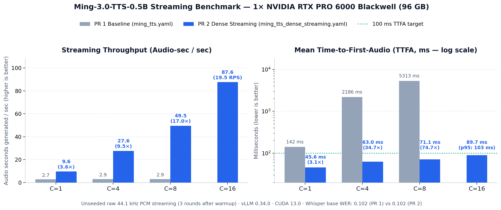
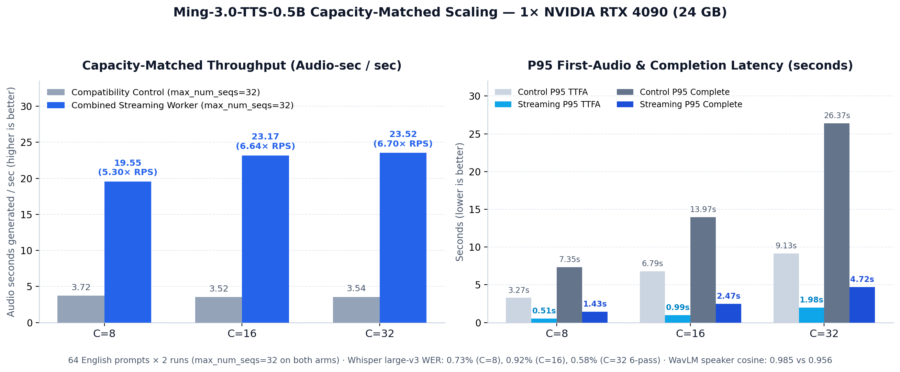

# Ming-3.0-TTS-0.5B Support & Dense Streaming Optimizations (vLLM-Omni Fork)

This fork of [vllm-project/vllm-omni](https://github.com/vllm-project/vllm-omni) adds support for [`inclusionAI/Ming-3.0-tts-0.5b`](https://huggingface.co/inclusionAI/Ming-3.0-tts-0.5b) (`patch_size=1` dense 0.5B checkpoint) and a high-throughput, low-latency dense streaming profile on CUDA.

## Branches & Upstream PRs

| Branch | Status | Scope |
| --- | --- | --- |
| [`pr/ming3-dense-0.5b`](https://github.com/d-nyamkhuu/vllm-omni/tree/pr/ming3-dense-0.5b) | Open PR [#10977](https://github.com/vllm-project/vllm-omni/pull/10977) | Model support for `inclusionAI/Ming-3.0-tts-0.5b` (offline `end2end.py` + online `/v1/audio/speech`, voice cloning, seed determinism), keeping legacy `Ming-omni-tts` (`patch_size=4`) unchanged |
| [`pr/ming3-dense-streaming-perf`](https://github.com/d-nyamkhuu/vllm-omni/tree/pr/ming3-dense-streaming-perf) | Stacked on `#10977` (contains **both PR 1 + PR 2**) | GPU-resident MRV2 acoustic feedback, vectorized + CUDA-graphed CFM decode, single batched D2H stop check, batched streaming AudioVAE, and bundled `vllm_omni/deploy/ming_tts_dense_streaming.yaml` |

> Want to try both PRs together right now? Check out [`pr/ming3-dense-streaming-perf`](https://github.com/d-nyamkhuu/vllm-omni/tree/pr/ming3-dense-streaming-perf).

## Measured Results (`inclusionAI/Ming-3.0-tts-0.5b`)

### 1× NVIDIA RTX PRO 6000 Blackwell (96 GB) — PR 1 vs. PR 2



Comparable unseeded raw PCM streaming (`stream=true`, `stream_format="audio"`, 44.1 kHz mono 16-bit PCM, 3 measured rounds per concurrency after warmup) on **1× NVIDIA RTX PRO 6000 Blackwell (96 GB)** with `vLLM 0.34.0`, `PyTorch 2.14.0+cu130`, `CUDA 13.0`, `Transformers 5.22.2`:

- **Baseline (PR 1, `vllm_omni/deploy/ming_tts.yaml`):** `max_num_seqs: 1`, `enforce_eager: true`, `latent_chunk_size: 25`
- **Dense Streaming (PR 2, `vllm_omni/deploy/ming_tts_dense_streaming.yaml`):** `max_num_seqs: 32`, `ming_dense_streaming: true`, Stage-0 PIECEWISE + CFM CUDA graphs, batched streaming VAE, `latent_chunk_size: 8`

| Concurrency | Profile | TTFA mean ± std (ms) | TTFA p95 (ms) | E2E mean (ms) | RTF mean | RPS mean | Audio-sec/s |
| ---: | --- | ---: | ---: | ---: | ---: | ---: | ---: |
| 1 | Baseline (`ming_tts.yaml`) | 141.78 ± 1.65 | 142.94 | 1496.59 | 0.3716 | 0.669 | 2.69 |
| 1 | **Dense Streaming** | **45.60 ± 0.43 (3.1×)** | **46.04** | **409.79 (3.65×)** | **0.1045 (3.6×)** | **2.438 (3.6×)** | **9.56 (3.6×)** |
| 4 | Baseline (`ming_tts.yaml`) | 2186.46 ± 82.88 | 4422.93 | 3584.91 | 0.8148 | 0.683 | 2.91 |
| 4 | **Dense Streaming** | **63.02 ± 2.24 (34.7×)** | **72.34** | **532.17 (6.7×)** | **0.1244** | **6.446 (9.4×)** | **27.58 (9.5×)** |
| 8 | Baseline (`ming_tts.yaml`) | 5312.65 ± 175.27 | 10587.45 | 6764.77 | 1.5298 | 0.663 | 2.91 |
| 8 | **Dense Streaming** | **71.13 ± 1.29 (74.7×)** | **80.07** | **617.74 (11.0×)** | **0.1370** | **10.964 (16.5×)** | **49.52 (17.0×)** |
| 16 | **Dense Streaming** | **89.74 ± 0.79** | **102.90** | **703.52** | **0.1567** | **19.475** | **87.57** |

- **Quality & accuracy:** Identical Whisper `base` WER (`0.102`) between PR 1 and PR 2, byte-exact `seed=42` determinism, matching English transcripts and durations against official upstream [`inclusionAI/Ming-3.0-tts`](https://github.com/inclusionAI/Ming-3.0-tts), and live non-regression verified on legacy `inclusionAI/Ming-omni-tts-0.5B`.
- **Memory & startup:** Peak GPU VRAM `45,034 MiB` (baseline) vs. `49,984 MiB` (dense streaming with `max_num_seqs: 32` + CUDA graphs); `enforce_eager: true` cleanly disables CFM/PIECEWISE graph capture.

### 1× NVIDIA RTX 4090 (24 GB) — Capacity-Matched Concurrent Scaling



Capacity-matched A/B evaluation (`max_num_seqs: 32` on **both** the compatibility control and the combined GPU-feedback streaming worker, pre-refactor `620c46da3`, 64 English voice-agent prompts × 2 runs after 32-request warmup, scored with Whisper `large-v3` and WavLM speaker similarity against official release audio):

| Concurrency | Control → Streaming Audio-sec/s | RPS Gain | P95 TTFA (s) | P95 Complete (s) | Whisper `large-v3` WER | WavLM Speaker Cosine |
| ---: | ---: | ---: | ---: | ---: | ---: | ---: |
| 8 | 3.72 → **19.55** | **5.30×** | 3.27 → **0.51** | 7.35 → **1.43** | 0.92% → **0.73%** | 0.961 → **0.985** |
| 16 | 3.52 → **23.17** | **6.64×** | 6.79 → **0.99** | 13.97 → **2.47** | 0.92% → **0.92%** | 0.956 → **0.985** |
| 32 | 3.54 → **23.52** | **6.70×** | 9.13 → **1.98** | 26.37 → **4.72** | 0.64% → **0.58%**\* | 0.956 → **0.985**\* |

\* 32-stream WER & WavLM speaker cosine from the 6-pass fixed-seed recheck (3,270 words across 64 prompts; one 16 s outlier occurred on a single prompt in round 1 of the initial 2-run sweep and did not recur across 6 fixed-seed repeats or a 7th load-order replay).

## Quickstart: Install & Run with Latest vLLM-Omni (`vllm==0.34.0`)

Requires Python 3.11–3.13 (3.12 recommended) on a CUDA BF16 GPU (tested on NVIDIA L4 24 GB and RTX PRO 6000 Blackwell 96 GB).

### Option A — Fresh `uv` environment

```bash
git clone --depth 1 -b pr/ming3-dense-streaming-perf https://github.com/d-nyamkhuu/vllm-omni.git
cd vllm-omni

uv venv .venv --python 3.12 --seed
source .venv/bin/activate

uv pip install vllm==0.34.0 setuptools_scm wheel
uv pip install --no-build-isolation --no-deps -e .
uv pip install soundfile soxr x-transformers einops onnxruntime omegaconf \
    diffusers==0.42.0 accelerate==1.13.0 prettytable aenum janus pyyaml msgpack av scipy
```

### Option B — Inside an existing `vllm-omni` (`vllm==0.34.0`) environment or Docker image

```bash
git clone --depth 1 -b pr/ming3-dense-streaming-perf https://github.com/d-nyamkhuu/vllm-omni.git
cd vllm-omni
uv pip install --no-build-isolation --no-deps -e .
```

### Serve Online (Dense Streaming Profile)

```bash
vllm serve inclusionAI/Ming-3.0-tts-0.5b --omni \
    --deploy-config vllm_omni/deploy/ming_tts_dense_streaming.yaml \
    --port 8091
```

*(For PR 1 baseline / eager mode only, pass `--deploy-config vllm_omni/deploy/ming_tts.yaml` instead.)*

**Synthesize WAV:**

```bash
curl -X POST http://localhost:8091/v1/audio/speech \
    -H "Content-Type: application/json" \
    -d '{
      "model": "inclusionAI/Ming-3.0-tts-0.5b",
      "input": "Streaming text to speech should start playing quickly while keeping natural rhythm.",
      "response_format": "wav",
      "seed": 42
    }' --output ming3_sample.wav
```

**Stream raw 44.1 kHz 16-bit mono PCM (omit `seed` for concurrent batching):**

```bash
curl -N -X POST http://localhost:8091/v1/audio/speech \
    -H "Content-Type: application/json" \
    -d '{
      "model": "inclusionAI/Ming-3.0-tts-0.5b",
      "input": "Streaming text to speech should start playing quickly while keeping natural rhythm.",
      "response_format": "pcm",
      "stream": true,
      "stream_format": "audio"
    }' --output ming3_stream.pcm
```

### Offline Inference

```bash
python examples/offline_inference/text_to_speech/ming_tts/end2end.py \
    --model inclusionAI/Ming-3.0-tts-0.5b \
    --deploy-config vllm_omni/deploy/ming_tts.yaml \
    --case style
```

---

For full upstream vLLM-Omni documentation, supported models, and installation guides, see [vllm-project/vllm-omni](https://github.com/vllm-project/vllm-omni).
